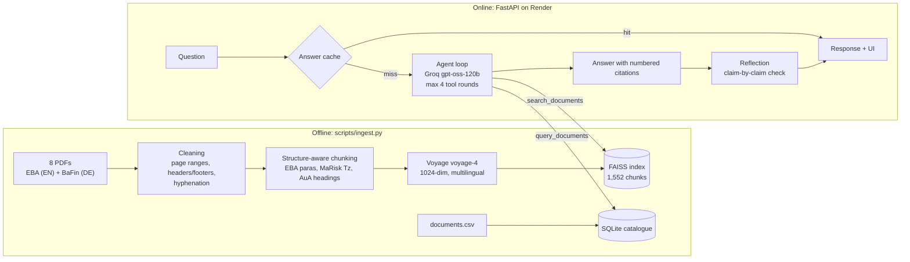

# RegRAG: agentic RAG over EU and German banking regulation

Ask a question about EU and German banking rules, in **English or German**. An agent decides which tools to use, searches eight regulatory documents (EBA guidelines in English, BaFin circulars in German), answers with a citation on every claim, and then **fact-checks its own answer** against the passages it cited.

**Live demo:** https://agentic-rag-bnbl.onrender.com
<sub>Free hosting: the first request after a quiet period wakes the server (about 1 minute). The example questions are cached and answer instantly. New questions usually take 20–90 s.</sub>

---

## What it does

- **Agentic retrieval.** The LLM gets two tools and chooses between them:
  - `query_documents`: a structured lookup in a SQLite catalogue (issuer, topic, language, date, which document amends or adopts which). This handles questions like *"Which AML documents were issued after 2022?"*.
  - `search_documents`: semantic search over 1,552 passages, optionally restricted to specific documents or a language.

  Chained questions ("find the documents, then search inside them") use both.
- **Cross-lingual answers.** Ask in English about German rules (or the other way round). Retrieval works across languages, and the answer comes back in the language of the question, keeping German legal terms in brackets, e.g. *back office (Marktfolge)*.
- **Citations you can check.** Every factual sentence cites a numbered source, e.g. `EBA/GL/2022/15, para 41, p.19` or `MaRisk BTO 1.1 Tz. 1`. In the UI, each citation opens the original passage.
- **Self-check (flag-only reflection, inspired by Self-RAG).** A second LLM call (temperature 0) splits the answer into claims and checks each one only against the passages it cites: supported, partially supported or unsupported. Problems are **shown to the user, never silently rewritten**.
- **Transparent reasoning.** The UI shows every tool call with its arguments, so you can see why the agent searched where it did.

## Corpus

| Document | Issuer | Language | Topic |
|---|---|---|---|
| EBA/GL/2019/02: Guidelines on outsourcing arrangements | EBA | EN | Outsourcing |
| EBA/GL/2020/06: Guidelines on loan origination and monitoring | EBA | EN | Credit risk |
| EBA/GL/2021/02: ML/TF Risk Factors Guidelines | EBA | EN | AML |
| EBA/GL/2022/15: Guidelines on remote customer onboarding | EBA | EN | AML |
| EBA/GL/2024/01: amending the ML/TF Risk Factors Guidelines (crypto-asset service providers) | EBA | EN | AML |
| Rundschreiben 06/2026: MaRisk (Mindestanforderungen an das Risikomanagement) | BaFin | DE | Risk management, outsourcing, credit |
| Auslegungs- und Anwendungshinweise zum GwG (Stand Juli 2025) | BaFin | DE | AML |
| Rundschreiben 14/2026: adopts EBA/GL/2026/01 (ancillary services) | BaFin | DE | Ancillary services |

The catalogue (`data/documents.csv`) also records relations: EBA/GL/2024/01 *amends* EBA/GL/2021/02, and Rundschreiben 14/2026 *adopts* EBA/GL/2026/01. The text of EBA/GL/2026/01 is deliberately **not** in the corpus, which lets the evaluation test whether the agent admits what it doesn't know.

## Architecture



### Ingestion (offline, run once)

1. **Load:** PDFs are read with PyMuPDF into LangChain `Document` objects, carrying metadata from the catalogue.
2. **Clean** (custom code): drop the EBA background and consultation-feedback sections (page ranges per document), detect repeated headers and footers, remove page numbers only at page edges (so MaRisk margin numbers *Tz.* survive), remove table-of-contents lines, and repair hyphenation with separate rules for German and English.
3. **Chunk by structure** (custom code), not by fixed size:
   - EBA: numbered paragraphs (`41.`, `4.2.1.`), detected by checking that numbers follow a sequence, with re-synchronisation when list items look like paragraph numbers.
   - MaRisk: modules (`AT 9`, `BTO 1.1`) and margin numbers (`Tz.`).
   - BaFin AuA: numbered headings.

   Overlong sections are split with LangChain's `RecursiveCharacterTextSplitter` (1,500 characters, 150 overlap). Each chunk is embedded together with its context, as `reference – title – section`.
4. **Embed and store:** Voyage `voyage-4` vectors go into a FAISS `IndexFlatIP` (normalised vectors, i.e. cosine similarity). Chunks go into `chunks.json`, and the catalogue into SQLite.

### Answering (online)

1. The agent (Groq `openai/gpt-oss-120b`, OpenAI-style function calling) gets a system prompt with ten rules (cite everything, keep normative strength: *should* is not *must*, answer in the question's language, say plainly when something isn't in the corpus) and a one-line guide to each document.
2. It calls tools for at most 4 rounds. Each tool result is registered under a number `[n]`, which the answer must cite.
3. Code post-processing normalises the citation formats the model sometimes invents (`【3†L10】`, `[1, 4]`).
4. The reflection step checks up to 10 claims against the **cited** sources only, plus a code check that every cited number exists.

## Design decisions

| Decision | Why |
|---|---|
| **Voyage `voyage-4` via API instead of a local embedding model** | A local multilingual model (`paraphrase-multilingual-mpnet`) performed well in tests but needs about 1 GB of RAM. The free Render instance has 512 MB. Voyage is multilingual, has a 32K-token context, and its free tier is enough for a corpus this size. |
| **FAISS exact search (`IndexFlatIP`)** | With 1,552 vectors, exact search takes milliseconds. Approximate indexes would only add error. |
| **SQLite catalogue as a separate tool** | "Which documents were issued after 2022?" is a database question, not a similarity question. Semantic search would answer it badly. Queries are fixed and parameterised, and the database connection is read-only. |
| **Document guide in the tool schema** | Without it, the agent guessed document IDs. With it, the agent picks the right document directly. |
| **Language-balanced search** | Same-language passages score systematically higher. If the best passage in each language is close to the overall best (within 0.15), each language gets up to half of the result slots. |
| **Answer language decided in code** | After thousands of tokens of German sources, the model sometimes forgot to answer in English. The question's language is now detected in code and repeated as a reminder next to every tool result. |
| **Flag-only reflection** (no automatic rewriting) | Rewriting doubles cost and latency on a free API budget, and it hides the problem. The checker can also be wrong itself (see Limitations), so the user should see both the answer and the doubt. |
| **Answer cache, per-visitor rate limit, one LLM call at a time** | The whole demo shares one free Groq budget (8K tokens/min, 200K/day). Cached answers are free and never rate-limited. New questions are limited to 3/min and 15/day per visitor, and run one at a time. |
| **Two requirements files** | Render only installs what the web app needs (`requirements.txt`). PDF parsing and text splitting are only needed to rebuild the index (`requirements-ingest.txt`). |

## Evaluation

There are 15 hand-written questions in five categories, each with expected tools, expected documents and key points checked against the source documents (`eval/questions.json`):

| Category | Example |
|---|---|
| catalogue (3) | *Which documents in the corpus are in German, and who issued them?* |
| content (4) | *What must a written outsourcing agreement for a critical or important function contain?* |
| cross_lingual (3) | *How must the front office and back office be separated in lending under German rules?* (EN question, DE source) |
| chained (3) | *Which document amended the ML/TF Risk Factors Guidelines, and what does it say about crypto-asset service providers?* |
| not_in_corpus (2) | *What does the EU AI Act require for credit scoring models?* |

**Metrics**
- **Routing:** did the agent use the right tools in the right order? Measured automatically. Chained questions must query the catalogue before searching.
- **Doc recall:** were the expected documents cited? Measured automatically.
- **Faithfulness:** the share of claims the reflection step marks as fully supported. Measured automatically.
- **Correctness:** graded by hand against the key points (1 / 0.5 / 0).
- **Reflection test:** three deliberately false claims are planted into real answers. Does the checker catch them?

### v1 → v2

v1 was the first complete system. Its errors drove the v2 changes: answer-language rule, keeping normative strength (*should* vs *must*), no added details, catalogue entries as citable evidence, language-balanced search, refusal rule for referenced-but-missing documents, and Unicode/citation normalisation.

| Metric | v1 | v2 |
|---|---|---|
| Routing correct | 87% | **93%** |
| Doc recall | 93% | 88% |
| Faithfulness | 78% | **81%** |
| Correctness (manual) | 80% | 80% |
| Cross-lingual correctness | 50% | **67%** |
| Not-in-corpus correctness | 75% | **100%** |
| Avg tokens per question | 8,217 | **7,187** |
| Avg tool calls | 1.8 | 1.5 |
| Reflection test (planted false claims caught) | 3/3 | 3/3 |

**v2 by category**

| Category | Routing | Doc recall | Faithfulness | Correctness |
|---|---|---|---|---|
| catalogue | 100% | 78% | 80% | 100% |
| content | 100% | 100% | 85% | 75% |
| cross_lingual | 100% | 67% | 93% | 67% |
| chained | 67% | 100% | 79% | 67% |
| not_in_corpus | 100% | 100% | 33% | 100% |

**How to read this honestly**
- With 15 questions, one answer moving from 1 to 0.5 changes correctness by about 3 points, and the LLM doesn't answer identically on every run. Correctness stayed flat because some answers improved (D2, N1, X2) while others slipped (D3, D4, H2). The clear gains are routing, cross-lingual answers, refusing out-of-corpus questions and token cost.
- The drop in doc recall comes from two cases. One catalogue answer named all three German documents correctly but cited only one of them. One German question retrieved the BaFin AuA instead of the EBA remote-onboarding guideline.
- Chained routing at 67% is the strict metric at work. For *"Compare the EBA and BaFin requirements on outsourcing"*, the agent skips the catalogue because the document guide already tells it which documents to search. That's arguably correct, but it's counted as a routing miss.
- The not-in-corpus faithfulness of 33% is a checker limitation, not a bad answer: a catalogue entry can never *prove* that a document is missing, so correct refusals get flagged.
- The answer-language fix was added after the v2 run, so it isn't reflected in these numbers.

Reproduce the evaluation: `python eval/run_eval.py run`, then `reflection-test`, `grade` (fill in `eval/grades.json`) and `report`. Raw results for both versions are in `eval/`.

## Limitations

- **Free-tier limits:** about 25 new questions per day across all visitors (Groq: 200K tokens/day), a slow shared CPU, and a ~1 minute cold start.
- **Same-language bias:** language balancing helps, but retrieval still tends to favour passages in the question's language (e.g. an English question about PEPs may use only the English EBA passages and miss the full German definition in the AuA).
- **The checker is an LLM too.** It can miss errors, and it occasionally flags correct statements (absence claims) or extracts a claim from the source instead of the answer. That's why it only flags and never rewrites.
- **Uncited summary sentences:** closing summaries sometimes carry no citation and get flagged.
- **Scope:** eight documents, a snapshot in time. EBA/GL/2019/02 is partly superseded by DORA for ICT outsourcing, and the corpus doesn't model such relations.
- **Scalability:** filtering happens after scoring all chunks. That's fine for 1,552 chunks, but a larger corpus would need metadata-filtered vector search.
- **Not legal advice.** This is a research demo.

## Run it locally

```bash
git clone https://github.com/khushi20802/Agentic-rag-EU-banking-regulation.git
cd Agentic-rag-EU-banking-regulation
python3.12 -m venv .venv && source .venv/bin/activate
pip install -r requirements.txt
```

Create a `.env` file (it's gitignored) with free API keys from [Groq](https://console.groq.com) and [Voyage AI](https://www.voyageai.com):

```text
GROQ_API_KEY=...
VOYAGE_API_KEY=...
```

```bash
uvicorn app.main:app --reload          # http://127.0.0.1:8000  (API docs at /docs)
python -m app.pipeline "Your question"  # or ask from the command line
```

The index is included in the repository, so you don't need to rebuild it. To rebuild it (e.g. after adding documents): `pip install -r requirements-ingest.txt`, put the PDFs into `data/raw_pdf/` with the file names from `data/documents.csv`, and run `python scripts/ingest.py`. Embeddings are cached per chunk, so an interrupted run resumes where it stopped.

## Project structure

```text
app/
  main.py         FastAPI: endpoints, answer cache, rate limiting
  pipeline.py     ask(): agent + reflection
  agent.py        system prompt, tool schemas, agent loop, citation handling
  tools.py        query_documents (SQLite) and search_documents (FAISS)
  reflect.py      claim-by-claim fact-check
  llm.py          Groq client with rate-limit handling
  embeddings.py   Voyage client with request/token pacing
scripts/
  ingest.py       load, clean, chunk, embed, build index + database
  warm_cache.py   pre-fill the cache with the example answers
eval/             questions, evaluation runner, v1 and v2 results
data/             catalogue, SQLite database, FAISS index, chunks, answer cache
static/           web UI (HTML, CSS, JavaScript)
```

## Tech stack

Python 3.12 · FastAPI · FAISS · Voyage AI `voyage-4` · Groq `openai/gpt-oss-120b` · SQLite · PyMuPDF · LangChain (`langchain-core`, text splitters) · plain HTML/CSS/JS with marked and DOMPurify · hosted on Render.

## Sources

Documents © European Banking Authority ([eba.europa.eu](https://www.eba.europa.eu)) and Bundesanstalt für Finanzdienstleistungsaufsicht ([bafin.de](https://www.bafin.de)). The original PDFs are not redistributed in this repository. Links to each one are in `data/documents.csv`. Answers are generated automatically and may contain errors: always check the cited original.